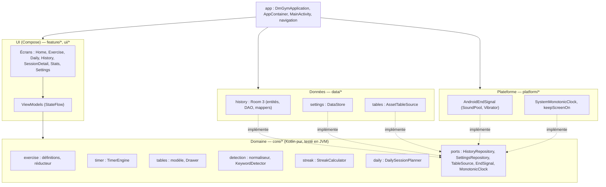
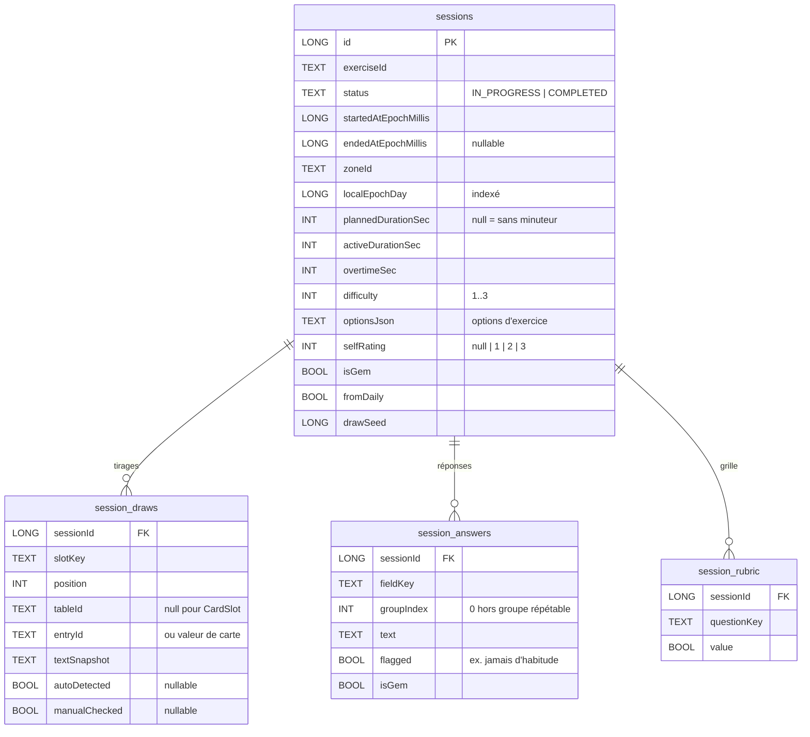
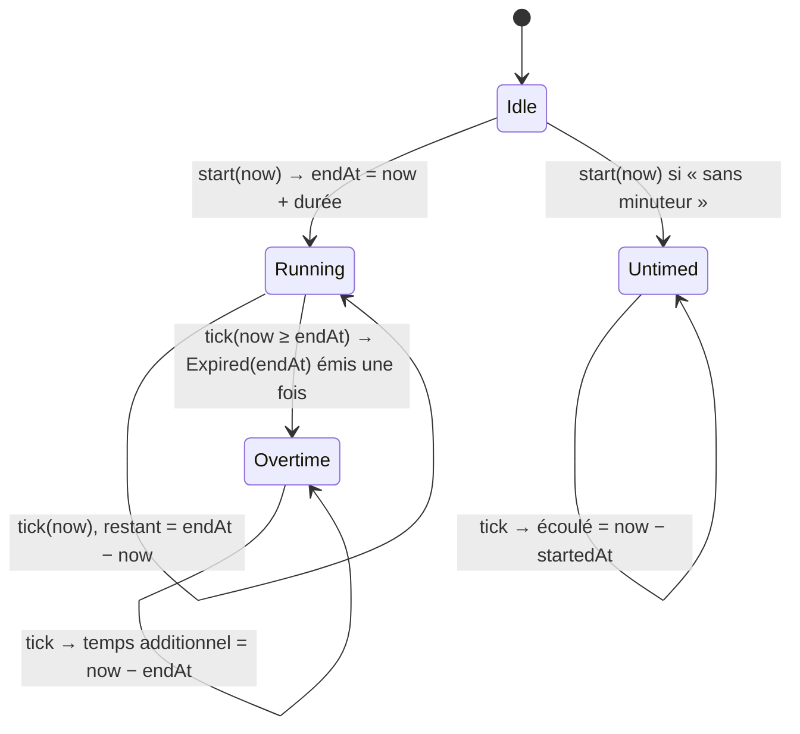
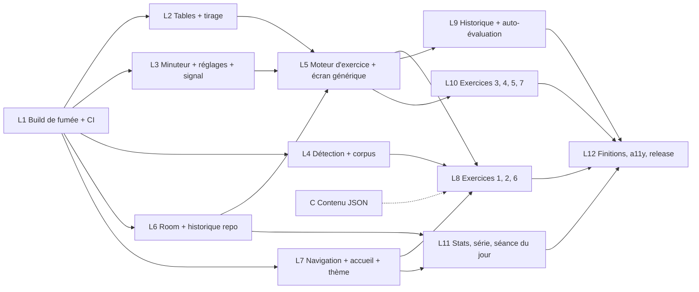

# DM Gym — Architecture technique

> Auteur : architecte. Version 1 du 2026-10-16. Entrées : `SPEC.md` (révisée le 2026-10-16), `docs/pilotage.md` (D1 à D24), `docs/research/01` à `03`.
> Les décisions structurantes sont dans `docs/adr/0001` à `0013`. Ce document les assemble ; en cas d'écart, **l'ADR fait foi**.

## Sommaire

1. Vue d'ensemble
2. Couches et paquets
3. Flux d'état (MVVM)
4. Modèle de données Room
5. Moteur d'exercice générique
6. Tables et moteur de tirage
7. Minuteur
8. Moteur de détection
9. Série de jours
10. Séance du jour
11. Réglages
12. Stratégie de test
13. CI et contrôle « hors ligne »
14. Découpage phase 3
15. Décisions ouvertes et risques

---

## 1. Vue d'ensemble

| Aspect | Choix | ADR |
|---|---|---|
| Langage, build | Kotlin 2.4.21 (Kotlin intégré à AGP 9.4.0), Gradle 9.7.x sous JDK 21, un seul module `app` | 0001, 0002 |
| SDK | minSdk 26, targetSdk 36, compileSdk 37 | 0001 |
| UI | Jetpack Compose (BOM 2026.09.00), Material 3 1.4.0, une seule Activity | 0001 |
| Navigation | Navigation 3 1.2.0 | 0003 |
| Persistance | Room 3.0.3 (historique), DataStore Preferences 1.2.1 (réglages) | 0004, 0013 |
| DI | manuelle (`AppContainer`) | 0005 |
| Contenu | tables JSON dans `assets/tables/`, kotlinx.serialization en mode strict | 0009 |
| Minuteur | horodatage monotone, sans service ; signal SoundPool + vibration | 0006 |
| Détection | normalisation + mots-clés du rédacteur ; le cochage manuel fait foi | 0008 |
| Exercices | définitions déclaratives, un écran et un ViewModel génériques | 0012 |
| Série, séance du jour | fonctions pures sur `localEpochDay` ; graine = date | 0011 |
| Tests | Jupiter 6 + Vintage, Robolectric, Turbine, Kover ≥ 80 % sur le domaine | 0007 |
| Hors ligne | liste blanche de permissions vérifiée en CI | 0010 |

Principes : la logique métier est en **Kotlin pur** dans `core/` (aucun import `android.*`). L'état est **immuable** (`data class`, `copy`) et exposé en `StateFlow`. **Horloges et aléatoire sont injectés.** Les textes d'interface vont dans `strings.xml`.

Identifiant d'application : `io.github.qnicoud.dmgym`, aussi utilisé comme `namespace` (décision D27).

---

## 2. Couches et paquets



Règle de dépendance : `feature → core ← data/platform`. `core` ne dépend de rien d'autre (kotlinx.coroutines et kotlinx.serialization seulement). `data` et `platform` implémentent les interfaces (« ports ») déclarées dans `core`. Seul `app/AppContainer` connaît les implémentations. Cette règle est vérifiée par la revue (`kotlin-reviewer`). Un test d'architecture JVM qui cherche `import android` dans `core/` est ajouté au lot 2.

### Arborescence (paquet racine `io.github.qnicoud.dmgym`)

```
app/src/main/java/io/github/qnicoud/dmgym/
  DmGymApplication.kt            # crée AppContainer
  MainActivity.kt                # setContent { DmGymApp() }, edge-to-edge
  app/
    AppContainer.kt              # DI manuelle (ADR 0005)
    DmGymApp.kt                  # thème + NavDisplay
    navigation/Routes.kt         # NavKey scellés (ADR 0003)
    navigation/AppNavDisplay.kt
  core/
    time/        MonotonicClock.kt, LocalDays.kt (localEpochDay)
    random/      RandomFactory.kt
    timer/       TimerEngine.kt, TimerState.kt, TimedEvent.kt, DurationBounds.kt
    tables/      TableFile.kt, TableEntry.kt, TableId.kt, TableSource.kt, TableRepository.kt, Drawer.kt
    detection/   TextNormalizer.kt, Tokenizer.kt, Stemmer.kt, KeywordDetector.kt, DamerauLevenshtein.kt
    exercise/    ExerciseDefinition.kt, DrawSlot.kt, FieldLayout.kt, ExerciseSession.kt,
                 ExerciseAction.kt, ExerciseReducer.kt, ExerciseRegistry.kt, Rubric.kt
    history/     HistoryRepository.kt (port), SessionRecord.kt (modèle du domaine)
    settings/    SettingsRepository.kt (port), Settings.kt
    signal/      EndSignal.kt (port)
    streak/      StreakCalculator.kt
    daily/       DailySessionPlanner.kt, DailyPlan.kt
  data/
    history/db/  DmGymDatabase.kt, entités, DAO
    history/     RoomHistoryRepository.kt, mappers
    settings/    DataStoreSettingsRepository.kt
    tables/      AssetTableSource.kt
  platform/      AndroidEndSignal.kt, SystemMonotonicClock.kt, KeepScreenOn.kt
  feature/
    home/        HomeScreen.kt, HomeViewModel.kt
    exercise/    ExerciseScreen.kt, ExerciseViewModel.kt, components/ (TimerBar, DrawCard,
                 FieldList, SequentialFields, RepeatableGroup, ElementChecklist, EndPanel)
    exercise/crazyeights/      CrazyEightsDefinition.kt
    exercise/constraintbox/    ConstraintBoxDefinition.kt
    exercise/coreimage/        CoreImageDefinition.kt
    exercise/statusnumbers/    StatusNumbersDefinition.kt, StatusCardHeader.kt
    exercise/decisionpoint/    DecisionPointDefinition.kt
    exercise/connectstory/     ConnectStoryDefinition.kt
    exercise/onepage/          OnePageDefinition.kt
    daily/       DailyScreen.kt, DailyViewModel.kt
    history/     HistoryScreen.kt, HistoryViewModel.kt, SessionDetailScreen.kt, SessionDetailViewModel.kt
    stats/       StatsScreen.kt, StatsViewModel.kt
    settings/    SettingsScreen.kt, SettingsViewModel.kt
  ui/
    theme/       Color.kt, Type.kt, Theme.kt   (design system de docs/ux/)
    components/  composants partagés
app/src/main/assets/tables/*.json            # redacteur-contenu
app/src/main/res/raw/end_beep.ogg            # bip CC0 ou original
app/schemas/                                 # schémas Room exportés (versionnés)
app/src/test/…                               # JVM : Jupiter + Robolectric (Vintage)
app/src/test/resources/detection/corpus.json # corpus doré (testeur)
app/src/androidTest/…                        # JUnit 4, appareil réel
```

---

## 3. Flux d'état (MVVM)

- Chaque ViewModel expose **un** `StateFlow<XxxUiState>` (une `data class` immuable) et des fonctions d'intention (`onFieldChanged`, `onReroll`…). Les événements ponctuels (signal de fin, navigation après « Terminer ») passent par un `Channel` exposé en `Flow`, consommé avec `LaunchedEffect` pendant l'état `STARTED`.
- L'UI collecte avec `collectAsStateWithLifecycle()`. Les composables sont sans état et prévisualisables.
- Le texte des champs est porté par des `TextFieldState` que **possède le ViewModel**, et qui sont initialisés depuis Room à la reprise. Leur contenu remonte au réducteur par `snapshotFlow`. C'est la solution recommandée par Google pour les états de champ hissés. Elle évite la double source de vérité.
- Les ViewModels sont créés par les fabriques de `AppContainer`, avec `createSavedStateHandle()` (ADR 0003, 0005).

---

## 4. Modèle de données Room

Base `dmgym.db`, schéma version 1, `AndroidSQLiteDriver` (ADR 0004). Quatre tables, toutes liées à `sessions` par `ON DELETE CASCADE`.



Détails :
- **Clés primaires** : `sessions.id` est autogénérée. Les autres tables ont une clé composite : `(sessionId, slotKey, position)`, `(sessionId, fieldKey, groupIndex)`, `(sessionId, questionKey)`. On les écrit avec des `@Upsert` idempotents.
- **Index** : `sessions(localEpochDay)`, `sessions(exerciseId, startedAtEpochMillis)`, `sessions(isGem)`.
- **`textSnapshot`** : copie du texte tiré au moment de la session. L'historique reste lisible si l'entrée est corrigée ou supprimée (ADR 0009). `entryId` permet des statistiques par entrée et l'exclusion des tirages récents.
- **Auto-évaluation (D18)** : `selfRating` = 1 « à retravailler », 2 « correct », 3 « réussi » (les libellés et pictogrammes sont fixés par l'UX), nul si l'utilisateur ne répond pas. La grille de 2 à 3 questions de la définition va dans `session_rubric`.
- **Bijou** : `sessions.isGem` marque la production entière. `session_answers.isGem` marque une réponse précise, par exemple « l'idée que je jouerais » dans Crazy Eights. Le filtre « bijoux » de l'historique prend les sessions qui ont l'un ou l'autre (voir la DÉCISION au §15).
- **Série** : `localEpochDay` est écrit une seule fois, à la création (ADR 0011).
- **`optionsJson`** : options de l'exercice (`{"counterStereotype":true,"shift":true,"mode":"table"}`), sérialisées par kotlinx.serialization. Ce sont des données descriptives, jamais requêtées.

DAO (extraits de signatures) :

```kotlin
@Dao interface SessionDao {
    @Insert suspend fun insert(session: SessionEntity): Long
    @Update suspend fun update(session: SessionEntity)
    @Query("SELECT * FROM sessions WHERE status = 'COMPLETED' AND (:exerciseId IS NULL OR exerciseId = :exerciseId) AND (:gemsOnly = 0 OR isGem = 1 OR id IN (SELECT sessionId FROM session_answers WHERE isGem = 1)) ORDER BY startedAtEpochMillis DESC")
    fun observeCompleted(exerciseId: String?, gemsOnly: Boolean): Flow<List<SessionEntity>>
    @Transaction @Query("SELECT * FROM sessions WHERE id = :id")
    fun observeDetail(id: Long): Flow<SessionWithChildren?>
    @Query("SELECT DISTINCT localEpochDay FROM sessions WHERE status = 'COMPLETED'")
    fun observePracticedDays(): Flow<List<Long>>
    @Query("SELECT COUNT(*) FROM sessions WHERE status = 'COMPLETED'")
    fun observeCompletedCount(): Flow<Int>
    @Query("SELECT exerciseId, COUNT(*) AS n FROM sessions WHERE status = 'COMPLETED' AND localEpochDay BETWEEN :from AND :to GROUP BY exerciseId")
    suspend fun countByExercise(from: Long, to: Long): List<ExerciseCount>
    @Query("DELETE FROM sessions WHERE status = 'IN_PROGRESS' AND id NOT IN (SELECT sessionId FROM session_answers WHERE text <> '') AND startedAtEpochMillis < :before")
    suspend fun purgeEmptyInProgress(before: Long)
}
```

Le port `core/history/HistoryRepository` manipule des modèles du domaine (`SessionRecord`, `DrawRecord`, `AnswerRecord`) ; les mappers sont dans `data/history`.

---

## 5. Moteur d'exercice générique

Référence : ADR 0012.

### 5.1 Modèle

```kotlin
data class ExerciseDefinition(
    val id: ExerciseId,
    @StringRes val name: Int, @StringRes val discipline: Int,
    @StringRes val instructions: Int, @StringRes val reminder: Int?,
    val timer: TimerPolicy,                  // Required(d) | Optional(suggested) | None
    val slots: List<DrawSlot>,
    val layout: FieldLayout,
    val detection: DetectionSpec? = null,
    val progress: ProgressRule = ProgressRule.None,
    val events: List<TimedEvent> = emptyList(),
    val options: List<ExerciseOption> = emptyList(),
    val rubric: List<RubricQuestion>,        // 2..3
    val warmUp: Boolean,                     // éligible comme échauffement (séance du jour)
)
```

`@StringRes` est une annotation de compilation (`androidx.annotation`) : elle reste compatible avec un `core` sans dépendance au runtime Android.

### 5.2 Les 7 exercices dans ce gabarit

| Exercice | Minuteur | Slots | Saisie | Spécificités |
|---|---|---|---|---|
| Crazy Eights | Required 8 min | `problems` ×1 | `Fixed` 8 champs | progression x/8 ; `TimedEvent.Periodic(60 s, haptic)` facultatif ; bijou par réponse |
| Constraint Box | Required 5 min | `places` ×1, `sensory_words` ×3 (sens distincts) | `Single` long | détection sur les 3 mots |
| Core Image | Required 10 min | `core_images` ×1, `threading_questions` (une par catégorie, dans l'ordre) | `Sequential` | bouton « question suivante » |
| Status Numbers | Required 3 min (durée maison, proposée ; à confirmer par l’UX) | `CardSlot` 1..10, `npc_roles` ×1 | `Single` court (notes facultatives) | en-tête carte ; options contre-stéréotype (filtre `rank:*` opposé à la carte), bascule (`TimedEvent.Once(40-60 %)` qui tire dans `status_shifts`) |
| Decision Point | Required 30 s | `surprise_situations` ×1 (mode table) / aucun (mode vidéo) | `Fixed` 3 champs avec drapeau | option mode ; en mode vidéo, bouton « Démarrer » très visible |
| Connect the Story | Required 10 min | `story_elements` ×5 (une par catégorie) | `Single` long | détection + liste de cases (ADR 0008) |
| One-Page | Optional (15 min conseillé, désactivé par défaut) | `one_page_situations` ×1 (mode sans campagne) | champ contexte + `RepeatableGroup` (nom, motivation, liens) ×5 max | exclu de la séance du jour par défaut |

Les durées par défaut sont des constantes de la définition, modifiables dans les réglages (ADR 0006, 0013).

### 5.3 État et réducteur

```kotlin
data class ExerciseSession(
    val definitionId: ExerciseId,
    val sessionId: Long?,                      // null avant « Démarrer »
    val phase: Phase,                          // Ready | Active | Ended
    val draws: List<Draw>,                     // slotKey, position, entry, check: ElementCheck?
    val answers: Map<AnswerKey, Answer>,       // (fieldKey, groupIndex) -> text, flagged, isGem
    val currentQuestion: Int,                  // Sequential
    val options: Map<String, Boolean>,
    val firedEvents: Set<String>,
    val selfRating: Int?, val isGem: Boolean, val rubric: Map<String, Boolean>,
)
data class ElementCheck(val auto: Boolean, val manual: Boolean?) { val checked get() = manual ?: auto }

sealed interface ExerciseAction {
    data class Drawn(val draws: List<Draw>) : ExerciseAction
    data class Rerolled(val slotKey: String?, val draws: List<Draw>) : ExerciseAction
    data class Started(val sessionId: Long) : ExerciseAction
    data class AnswerChanged(val key: AnswerKey, val text: String) : ExerciseAction
    data class FlagToggled(val key: AnswerKey) : ExerciseAction
    data class AutoDetected(val detected: Map<String, Boolean>) : ExerciseAction
    data class CheckToggled(val slotKey: String, val position: Int) : ExerciseAction
    data object NextQuestion : ExerciseAction
    data class EventFired(val eventId: String, val draws: List<Draw>) : ExerciseAction
    data object Finished : ExerciseAction
    data class Assessed(val rating: Int?, val isGem: Boolean, val rubric: Map<String, Boolean>) : ExerciseAction
}
fun reduce(state: ExerciseSession, action: ExerciseAction): ExerciseSession
```

Le tirage (qui a besoin de `Random` et des tables) est fait **hors du réducteur**, par `Drawer`, et le résultat arrive dans l'action. Le réducteur reste déterministe.

### 5.4 Cycle de vie d'une session et sauvegarde automatique

```mermaid
stateDiagram-v2
    [*] --> Ready: ouverture (tirage affiché, relançable)
    Ready --> Active: Démarrer → INSERT session IN_PROGRESS, minuteur lancé
    Active --> Active: saisie → upsert réponses (debounce 1 s) ; relance → upsert tirages
    Active --> Ended: Terminer, ou sortie de l'écran avec contenu ou temps écoulé
    Ended --> [*]: status COMPLETED ; panneau d'auto-évaluation facultatif (modifiable depuis l'historique)
    Active --> [*]: sortie sans contenu ni temps écoulé → session supprimée
```

- **Reprise** : `sessionId` est dans le `SavedStateHandle`. Après une mort du processus, le ViewModel recharge la session depuis Room (réponses, tirages, cases) et le minuteur depuis le `SavedStateHandle` (§7). La route `Exercise(resumeSessionId)` permet aussi de reprendre une session `IN_PROGRESS` depuis l'accueil.
- **Écritures** : réponses avec `debounce(1 s)` + écriture immédiate dans `onStop` et dans « Terminer ». Les tirages et les cases sont écrits à chaque changement. Toutes les écritures passent par `HistoryRepository` sur `ioDispatcher`.
- **Ménage** : au démarrage de l'app, `purgeEmptyInProgress(before = maintenant − 24 h)`.
- **Relance après le démarrage** : elle est autorisée. Les réponses déjà saisies sont conservées ; les cases du slot relancé sont réinitialisées.

---

## 6. Tables et moteur de tirage

Référence : ADR 0009.

- `TableSource` (port) : `suspend fun load(id: TableId): TableFile`. Implémentation : `AssetTableSource(assets, json, ioDispatcher)`.
- `TableRepository` : charge chaque table **à la demande, une seule fois** (cache en mémoire protégé par un `Mutex`), puis expose `suspend fun table(id): TableFile`. Le volume (une dizaine de fichiers de quelques dizaines de Ko) ne justifie pas de préchargement.
- `Drawer` (pur) :

```kotlin
class Drawer(private val random: Random) {
    fun draw(
        table: TableFile, count: Int,
        category: String? = null, difficulty: IntRange = 1..3,
        distinctBy: DistinctBy = DistinctBy.Id,       // Id | Category
        exclude: Set<String> = emptySet(),             // entrée courante (relance), tirages récents
        tagFilter: (List<String>) -> Boolean = { true },
    ): List<TableEntry>
}
```

Règles : tirage **sans remise**. Si le filtre est trop restrictif, on relâche dans l'ordre `exclude`, puis `difficulty`, et on lève une erreur explicite seulement si la table ne contient pas `count` entrées. Une relance exclut l'entrée affichée. L'exclusion des tirages récents (entrées vues dans les 5 dernières sessions de l'exercice) est prévue, mais facultative au lot 5.
- **Graine** : `drawSeed` est enregistré avec la session. Il sert au diagnostic et n'est pas utilisé pour rejouer. La séance du jour utilise sa propre graine (§10).
- **Difficulté** : en v1, le niveau vaut 1..3 (toutes les entrées) par défaut. Le champ est prêt pour la progression suggérée de la v1.1.

---

## 7. Minuteur

Référence : ADR 0006.



| Situation | Comportement |
|---|---|
| **Rotation** | Le ViewModel survit, donc l'état aussi. Les tics reprennent à la recomposition. `signalDelivered` empêche de rejouer le signal. |
| **Arrière-plan** | La collecte de l'état s'arrête (`collectAsStateWithLifecycle`), donc les tics aussi. Pas de son ni de vibration hors de l'écran. Au retour, l'état est recalculé immédiatement depuis `endAt`. |
| **Retour après l'échéance** | L'état passe directement en `Overtime`. L'événement `Expired` est **périmé** (`now − endAt > 2 s`), donc ignoré : pas de signal, « temps écoulé » est affiché. |
| **Mort du processus** | `SavedStateHandle` contient `endAtWallMillis`, `durationMs`, `signalDelivered`, `sessionId`. On reconstruit `endAtElapsed = elapsedNow + (endAtWall − wallNow)`. |
| **Redémarrage de l'appareil** | Même calcul (seule l'heure murale est fiable). La session `IN_PROGRESS` est reprise depuis l'accueil. |
| **Fin au premier plan** | `EndSignal.play(settings)` : vibration (deux impulsions) si activée et `hasVibrator()` ; bip SoundPool si activé **et** `ringerMode == NORMAL`, sans focus audio. |
| **Écran allumé** | `keepScreenOn` en `Running` et en `Overtime`, désactivé en sortie d'écran. |
| **Événements programmés** | Évalués au même tic, avec la même règle de péremption. La bascule de Status, si elle a été manquée, s'affiche au retour sans vibration. |

Tic : `flow { while (true) { emit(monotonicClock.now()); delay(250) } }` combiné à l'état, `stateIn(viewModelScope, WhileSubscribed(5_000))`. L'affichage est arrondi à la seconde supérieure pendant le décompte. Pour l'accessibilité, il n'y a pas de live region seconde par seconde. Des annonces ponctuelles (mi-parcours, dernière minute, fin) sont émises comme événements, selon les spécifications de l'UX.

---

## 8. Moteur de détection

Référence : ADR 0008.

```
texte ──Tokenizer(\p{L}[\p{L}\p{M}]*)──▶ jetons (plage, forme brute)
      ──TextNormalizer (lowercase ROOT, NFD, −\p{Mn}, œ→oe, æ→ae)──▶ formes normalisées
      ──Stemmer (Identity en v1)──▶ clés
cibles (entrées tirées) : keywords → même pipeline → suites de clés
KeywordDetector.detect(text, targets): DetectionResult(matches: Map<TargetId, List<IntRange>>)
```

- Correspondance : suite contiguë de jetons égaux. Avec `fuzzy`, Damerau-Levenshtein ≤ 1 sur les jetons de 8 lettres ou plus.
- Complexité : O(jetons × mots-clés), avec un index par premier jeton. L'objectif est < 1 ms pour 5 000 caractères, mesuré dans un test de performance indicatif.
- Interface : surlignage synchrone par `OutputTransformation` (gras + souligné + fond), avec mémorisation par texte. Les cases sont recalculées après un debounce de 300 ms et passent par `AutoDetected`. Le cochage manuel passe par `CheckToggled` et fait foi.
- Corpus doré : `src/test/resources/detection/corpus.json` (`{ "cases": [ { "text": "...", "targets": [ { "category": "object", "keywords": [...] } ], "expected": ["object"] } ] }`). Seuils : rappel ≥ 0,85, précision ≥ 0,90.

---

## 9. Série de jours

Référence : ADR 0011. `computeStreak(days, sessions, today)` est une fonction pure. Elle est alimentée par `observePracticedDays()` et `observeCompletedCount()` ; `today = LocalDate.now(clock).toEpochDay()`. L'écran Statistiques affiche dans cet ordre : nombre de sessions, jours pratiqués, série courante (avec l'indication « jour de grâce utilisé » si c'est le cas), meilleure série. Pour le passage de minuit pendant que l'écran est ouvert, `StatsViewModel` recalcule `today` à chaque `ON_RESUME`, et un tic à minuit est inutile.

---

## 10. Séance du jour

Référence : ADR 0011. `DailyViewModel` combine :
- `plan(today, stats(< today), catalogue, options)` (pur, `Random(today)`) ;
- les remplacements stockés dans DataStore ;
- les sessions `COMPLETED` d'aujourd'hui, pour l'avancement.

Remplacer un exercice met à jour DataStore. Lancer un exercice navigue vers `Exercise(id, fromDaily = true)`. Le plan de la veille est recalculé à la demande pour appliquer la règle « pas le même exercice à la même position ».

---

## 11. Réglages

Référence : ADR 0013. DataStore Preferences : son, vibration, durée par exercice, sans minuteur par exercice, One-Page dans la séance du jour, remplacements du jour. L'option vibration est masquée si `hasVibrator()` est faux. L'écran de réglages montre les bornes de durée calculées par `DurationBounds`.

---

## 12. Stratégie de test

Référence : ADR 0007.

| Niveau | Outils | Cible |
|---|---|---|
| Unitaire pur (JVM) | Jupiter 6, `runTest`, Turbine | `TimerEngine`, `Drawer`, `KeywordDetector` + corpus doré, `TextNormalizer`, `StreakCalculator`, `DailySessionPlanner`, `ExerciseReducer`, chaque `*Definition`, `DurationBounds`, ViewModels avec doublures |
| Contenu (JVM) | Jupiter | `TablesContentTest` sur les vrais `assets/tables/*.json` |
| Intégration locale | Robolectric 4.17 (Vintage) | DAO Room 3 en mémoire, `RoomHistoryRepository`, `DataStoreSettingsRepository`, `AssetTableSource` |
| UI locale | Robolectric + `createComposeRule` | `ExerciseScreen` (saisie, temps additionnel non bloquant, cases), accueil, historique |
| Instrumenté (manuel, appareil réel) | JUnit 4 | rotation pendant le minuteur, vibration et son selon le mode sonnerie, TalkBack |
| Architecture | Jupiter | aucun `import android.` dans `core/` |

- **Doublures** : `FakeMonotonicClock`, `Clock.fixed`, `Random(42)`, `FakeHistoryRepository`, `FakeSettingsRepository`, `FakeTableSource`, `RecordingEndSignal`.
- **Couverture** : Kover ≥ 80 % de lignes sur `core`, `data` (hors code généré), ViewModels et définitions. `koverVerify` en CI.
- **TDD** : chaque lot écrit ses tests d'abord (règle du projet). Le `testeur` prépare le corpus doré et le plan de test (`docs/qa/`).

---

## 13. CI et contrôle « hors ligne »

- `.github/workflows/ci.yml` : checkout v7 → setup-java v6 (Temurin 21) → setup-gradle v6 → `./gradlew ktlintCheck lintDebug testDebugUnitTest koverVerify verifyPermissions assembleDebug`.
- `verify<Variant>Permissions` (ADR 0010) : lit le manifeste fusionné (`SingleArtifact.MERGED_MANIFEST`) et échoue sur tout `uses-permission` hors de la liste blanche `{VIBRATE, ${applicationId}.DYNAMIC_RECEIVER_NOT_EXPORTED_PERMISSION}`. La tâche est rattachée à `check`.

```kotlin
// extrait indicatif de app/build.gradle.kts
androidComponents.onVariants { variant ->
    val task = tasks.register<VerifyPermissionsTask>("verify${variant.name.replaceFirstChar(Char::uppercase)}Permissions") {
        allowed.set(listOf("android.permission.VIBRATE", "${variant.applicationId.get()}.DYNAMIC_RECEIVER_NOT_EXPORTED_PERMISSION"))
    }
    variant.artifacts.use(task).wiredWith { it.mergedManifest }.toListenTo(SingleArtifact.MERGED_MANIFEST)
}
```

La méthode exacte de liaison à l'artefact (`toListenTo` ou `get(SingleArtifact.MERGED_MANIFEST)` passé en entrée) sera confirmée au lot 1 sur AGP 9.4. Le principe (lire l'artefact, ne pas deviner le chemin dans `build/intermediates`) est imposé.
- Le manifeste n'autorise que le transfert d'appareil à appareil : `dataExtractionRules` (API 31+) exclut `cloud-backup` et inclut `device-transfer`, `fullBackupContent` (API 26-30) exclut tout (décision D26).

---

## 14. Découpage phase 3

Les lots sont ordonnés. Ceux d'une même « vague » sont **indépendants** et peuvent être confiés en parallèle. Chaque lot suit le cycle : `dev-android` en TDD → `testeur` → revue `kotlin-reviewer` → commit (`feat:`, `test:`…) après accord de l'utilisateur.



Vagues : **1** : L1 → **2** : L2, L3, L4, L6, L7 (+ C, tâche du rédacteur dès maintenant) → **3** : L5 → **4** : L8, L9, L10, L11 → **5** : L12.

Écart assumé par rapport à l'ordre de la SPEC : Room (L6) passe **avant** les exercices, parce que la sauvegarde automatique fait partie du moteur générique. Faire L6 en vague 2, en parallèle, ne retarde rien.

### L1 — Build de test minimal (fumée) + CI

- **Périmètre** :
  - wrapper Gradle 9.7.x ; `gradle/gradle-daemon-jvm.properties` (JDK 21) ; `libs.versions.toml` complet (ADR 0001) ;
  - module `app` (AGP 9.4.0, Kotlin intégré, plugin Compose, KSP 2.3.12, plugin `androidx.room3`, sérialisation, Kover) ;
  - `MainActivity` qui affiche un écran Compose « DM Gym » (texte de `strings.xml`) ;
  - **une entité Room 3** (`SmokeEntity`), un DAO, `DmGymDatabase` avec `AndroidSQLiteDriver`, schéma exporté ;
  - **une classe `@Serializable`** décodée depuis un JSON de test ;
  - configuration JUnit Platform + Vintage ; `verifyPermissions` ; workflow CI ; ktlint ; `README` (commande de premier lancement sous JDK 21).
- **Dépendances** : aucune.
- **Tests attendus** :
  - Jupiter : le décodage strict d'un JSON réussit, et une clé inconnue échoue ;
  - Robolectric (Vintage) : insertion et lecture de `SmokeEntity` en mémoire ;
  - `verifyPermissions` échoue sur un manifeste de test qui contient `INTERNET`.
- **Critère de fin** : `./gradlew clean check assembleDebug` est vert sous JDK 21 ; `./gradlew buildEnvironment` montre KGP 2.4.21 ; le code Room est généré par KSP ; l'APK debug s'installe (`adb install`) et affiche l'écran ; la CI est verte ; les versions réellement utilisées sont reportées dans l'ADR 0001 si elles diffèrent.
- **Marche à suivre en cas d'échec**, dans l'ordre, une seule variable à la fois, en notant chaque essai dans le compte rendu :
  1. Échec de configuration AGP/KGP (Kotlin intégré, version de plugin) → **AGP 9.3.1**, Gradle inchangé.
  2. Échec de KSP lui-même (erreur du processeur, incompatibilité d'API Kotlin) → dernière KSP publiée. Si l'échec persiste, **arrêt et remontée à l'orchestrateur** → redescendre à la dernière Kotlin 2.3.x et mettre à jour l'ADR 0001 (décision D25).
  3. KSP fonctionne mais Room 3 échoue (génération, driver, plugin `room3`) → **Room 2.8.5** (`androidx.room`, plugin `androidx.room`) ; mettre à jour l'ADR 0004.
  4. Échec de JUnit Platform ou Vintage avec Robolectric → JUnit 4 partout (ADR 0007).
  5. Échec de Kover avec AGP 9.4 → désactiver `koverVerify` temporairement, ouvrir un point dans `docs/pilotage.md`.
  - Les replis 1, 3 et 4 sont pré-autorisés par les ADR. Tout autre écart doit être remonté.
- **Agents** : `dev-android` (+ `gradle-build`/`kotlin-build-resolver` si le build casse).

### L2 — Tables JSON et moteur de tirage

- **Périmètre** : `core/tables` (`TableFile`, `TableEntry`, `TableId`, `TableSource`, `TableRepository`, `Drawer`) ; `data/tables/AssetTableSource` ; `TablesContentTest` (ADR 0009) ; test d'architecture (pas d'`android` dans `core`) ; fixtures de test dans `src/test/resources/tables/`.
- **Dépendances** : L1.
- **Tests attendus** : tirage sans remise, déterministe avec `Random(42)`, `distinctBy = Category`, relâchement des filtres, erreur si la table est trop petite, cache chargé une seule fois. `TablesContentTest` est paramétré par table. Il est **ignoré (`assumeTrue`) pour une table encore absente**, mais il échoue sur toute table présente et invalide. L12 retire cette tolérance.
- **Critère de fin** : couverture de `core/tables` ≥ 90 % ; `AssetTableSource` testé sous Robolectric sur une fixture.

### L3 — Minuteur, réglages, signal de fin

- **Périmètre** : `core/time`, `core/timer` (`TimerEngine`, `TimerState`, `TimedEvent`, `DurationBounds`) ; `core/settings` + `DataStoreSettingsRepository` ; `core/signal/EndSignal` + `platform/AndroidEndSignal` + `SystemMonotonicClock` + `KeepScreenOn` ; permission `VIBRATE` ; bip `res/raw/end_beep.ogg` (CC0 ou original, licence dans `docs/licenses.md`).
- **Dépendances** : L1.
- **Tests attendus** : décompte, expiration émise une seule fois, temps additionnel, `Untimed`, péremption de l'événement (> 2 s), restauration depuis l'heure murale, événements périodiques et uniques (y compris tirage dans 40-60 % avec `Random`), bornes de durée ; DataStore sous Robolectric (valeurs par défaut, écriture bornée, valeur corrompue).
- **Critère de fin** : couverture de `core/timer` ≥ 90 % ; `AndroidEndSignal` vérifié à la main sur un appareil (sonnerie, vibreur, silencieux), avec le résultat noté dans `docs/qa/`.

### L4 — Moteur de détection et corpus doré

- **Périmètre** : `core/detection` (Tokenizer, TextNormalizer, Stemmer/IdentityStemmer, DamerauLevenshtein, KeywordDetector) ; corpus `src/test/resources/detection/corpus.json` (rédigé par le `testeur`, environ 100 cas par catégorie, pièges compris) ; rapport de mesure dans `docs/qa/detection.md`.
- **Dépendances** : L1. Le corpus ne dépend que de l'ADR 0008.
- **Tests attendus** : normalisation (accents, œ/æ, apostrophes ’, majuscules), positions dans le texte d'origine, mots-clés de plusieurs jetons, élisions, `fuzzy` (≥ 8 lettres seulement), corpus avec rappel ≥ 0,85 et précision ≥ 0,90, performance indicative.
- **Critère de fin** : seuils atteints, **ou** rapport qui montre un rappel insuffisant avec une proposition d'activer Snowball (nouvelle tâche, pas de branchement silencieux).

### L6 — Room 3 et repository d'historique

- **Périmètre** : entités et DAO du §4 (on remplace `SmokeEntity`), `DmGymDatabase` v1, schéma exporté, `HistoryRepository` (port dans `core/history`) + `RoomHistoryRepository` + mappers, `purgeEmptyInProgress` au démarrage.
- **Dépendances** : L1.
- **Tests attendus** (Robolectric, base en mémoire) : insertion de session et upserts idempotents, cascade, filtre par exercice et par bijou, jours pratiqués distincts, comptages, purge, lecture du détail avec ses enfants.
- **Critère de fin** : schéma `1.json` versionné ; le repository est couvert à ≥ 80 %.

### L7 — Navigation, thème, accueil, réglages

- **Périmètre** : `AppContainer` (ADR 0005), `Routes` + `AppNavDisplay` (ADR 0003, décorateurs ViewModel et SavedState), thème Material 3 conforme à `docs/ux/` ; `HomeScreen` (liste des 7 exercices : nom, discipline, durée réglée), `SettingsScreen` ; écrans provisoires pour Exercise, Daily, History et Stats.
- **Dépendances** : L1. Il faut aussi le design system de `docs/ux/` ; s'il est absent, on pose un thème provisoire.
- **Tests attendus** : `HomeViewModel` (durées lues dans les réglages), `SettingsViewModel` (bornes), navigation en JVM (manipulation de la pile), test Compose Robolectric de l'accueil (7 éléments, clic → route `Exercise`).
- **Critère de fin** : on navigue entre tous les écrans, l'état est conservé à la rotation, le retour prédictif fonctionne, il n'y a aucune chaîne en dur (Lint).

### C — Contenu (redacteur-contenu, en continu dès maintenant)

- **Périmètre** : les 10 fichiers de `app/src/main/assets/tables/` au format de l'ADR 0009.
- **Dépendances** : aucune (le format est figé).
- **Critère de fin** : `TablesContentTest` est vert sur les 10 fichiers.

### L5 — Moteur d'exercice générique et écran générique

- **Périmètre** : `core/exercise` (définition, slots, layouts, `ExerciseSession`, actions, `reduce`, `ExerciseRegistry`) ; `ExerciseViewModel` (tirage par `Drawer`, minuteur, sauvegarde automatique, reprise après la mort du processus, canal d'événements) ; `ExerciseScreen` et ses composants (TimerBar, DrawCard, FieldList, EndPanel avec 3 niveaux, bijou et grille) ; `keepScreenOn` ; branchement d'un **exercice de démonstration** de test (1 slot, 2 champs) qui ne sera pas livré.
- **Dépendances** : L2, L3, L6 (L4 n'est requis qu'en L8).
- **Tests attendus** : réducteur exhaustif (toutes les actions, relance avant et après le démarrage, cases auto et manuelles, questions séquentielles, groupes répétables, fin, auto-évaluation) ; ViewModel avec doublures et Turbine (démarrage → insertion, saisie → upsert avec debounce, sortie sans contenu → suppression, signal publié une seule fois, reprise depuis le `SavedStateHandle`) ; test Compose (saisie possible en temps additionnel, aucun dialogue).
- **Critère de fin** : un exercice de démonstration se joue de bout en bout dans l'app, avec la session visible en base ; la couverture de `core/exercise` est ≥ 90 %.

### L8 — Exercices 1, 2, 6 (Crazy Eights, Constraint Box, Connect the Story)

- **Périmètre** : trois définitions ; intégration de la détection (surlignage `OutputTransformation` ou repli, `ElementChecklist`) ; progression x/8 ; rappel de 60 s (option) ; grilles d'auto-évaluation propres à chaque exercice ; chaînes.
- **Dépendances** : L4, L5, L7 ; contenu C (`problems`, `places`, `sensory_words`, `story_elements`) ou fixtures.
- **Tests attendus** : test de chaque définition (slots, sens distincts, une entrée par catégorie) ; ViewModel avec détection (pré-cochage, puis le manuel fait foi après un nouveau calcul) ; test Compose (surlignage présent, cases annoncées par TalkBack avec `contentDescription`/`stateDescription`).
- **Critère de fin** : les trois exercices sont jouables et sauvegardés ; la mesure de performance du surlignage est notée.

### L9 — Historique et auto-évaluation

- **Périmètre** : `HistoryScreen` (liste, filtre par exercice, filtre bijoux), `SessionDetailScreen` (tirage, réponses, auto-évaluation modifiable, bouton « refaire avec un nouveau tirage »), reprise d'une session `IN_PROGRESS` depuis l'accueil.
- **Dépendances** : L5 (et donc L6).
- **Tests attendus** : ViewModels (filtres, détail, modification de l'auto-évaluation) ; test Compose de la liste vide et de la liste filtrée.
- **Critère de fin** : chaque session terminée est consultable et son auto-évaluation est modifiable.

### L10 — Exercices 3, 4, 5, 7 (Core Image, Status Numbers, Decision Point, One-Page)

- **Périmètre** : quatre définitions ; `Sequential` (Core Image), `CardSlot` + en-tête carte + options contre-stéréotype et bascule (Status), mode vidéo/table + drapeau « jamais d'habitude » (Decision Point), `RepeatableGroup` + contexte + mode sans campagne (One-Page).
- **Dépendances** : L5 ; contenu C. Il peut être découpé en 4 sous-tâches parallèles, une par exercice.
- **Tests attendus** : définitions ; réducteur pour la question suivante et les groupes ; bascule déclenchée entre 40 et 60 % avec `Random` fixé ; filtre contre-stéréotype ; One-Page sans minuteur par défaut.
- **Critère de fin** : les 7 exercices sont jouables et sauvegardés.

### L11 — Statistiques, série, séance du jour

- **Périmètre** : `core/streak`, `core/daily`, `StatsScreen`, `DailyScreen` (3 exercices, remplacement, avancement), entrée « Séance du jour » sur l'accueil.
- **Dépendances** : L6, L7. Les sessions réelles (L5) servent aux tests manuels seulement.
- **Tests attendus** : tous les cas de l'ADR 0011 (grâce, deux trous, changement d'heure, changement de fuseau, horloge dans le passé, aujourd'hui non fait) ; planificateur (déterminisme par date, 3 exercices distincts, One-Page exclu, échauffement, zone faible, contrainte de la veille, stabilité dans la journée après une session) ; remplacements dans DataStore.
- **Critère de fin** : couverture de `core/streak` et `core/daily` ≥ 95 % ; l'écran Stats affiche le nombre de sessions en premier.

### L12 — Finitions et release

- **Périmètre** : accessibilité (TalkBack, tailles de police 200 %, contrastes, annonces ponctuelles du minuteur), retrait de la tolérance « table absente » de `TablesContentTest`, R8/minification + règles kotlinx.serialization, `dataExtractionRules` (transfert d'appareil seulement, D26) vérifiées, icône, tests manuels sur appareil réel (`docs/qa/`), `security-reviewer`.
- **Dépendances** : L8 à L11.
- **Critère de fin** : `./gradlew check assembleRelease` est vert ; la checklist QA est passée ; le manifeste release ne contient que les permissions de la liste blanche.

---

## 15. Décisions ouvertes et risques

> **Tranchées le 2026-10-16 (D25–D27 et D33 dans l'artefact de pilotage)** : toutes les recommandations ci-dessous sont retenues — repli Kotlin 2.3.x si KSP échoue ; sauvegarde limitée au transfert d'appareil à appareil (`dataExtractionRules`, cloud exclu) ; identifiant `io.github.qnicoud.dmgym` ; bijou stocké aux deux niveaux, exposé par session à l'écran en v1.

### Décisions ouvertes

- DÉCISION: KSP 2.3.12 échoue avec Kotlin 2.4.21 au lot 1 (le repli Room 2 ne règle pas ce cas, car Room 2 passe aussi par KSP) — options : redescendre à Kotlin 2.3.x (fenêtre KSP documentée) / attendre une KSP compatible / KAPT avec Room 2 — **recommandation : Kotlin 2.3.x, la dernière version corrective, avec mise à jour de l'ADR 0001**.
- DÉCISION: sauvegarde automatique Android (`allowBackup`) — `false` (rien ne sort de l'appareil) / transfert d'appareil à appareil seulement (`dataExtractionRules`, sans cloud) / sauvegarde cloud Google — **recommandation : transfert d'appareil seulement**, cohérent avec « 100 % hors ligne » sans perte de l'historique lors d'un changement de téléphone.
- DÉCISION: identifiant d'application (non modifiable après publication) — `io.github.qnicoud.dmgym` / autre domaine — **recommandation : `io.github.qnicoud.dmgym`**.
- DÉCISION (pour l'UX) : bijou au niveau de la session, d'une réponse, ou des deux — **recommandation : les deux sont stockés ; l'UX choisit ce qui est exposé par exercice** (une réponse pour Crazy Eights et Decision Point, la session pour les autres).

### Risques

| Risque | Niveau | Mitigation |
|---|---|---|
| Combinaison KSP 2.3.12 / Kotlin 2.4.21 / AGP 9.4 non confirmée | Élevé | L1 en premier, marche à suivre du §14 |
| Rappel de la détection en français | Élevé | corpus doré (L4), `keywords` soignés, Snowball derrière `Stemmer` |
| `OutputTransformation.addStyle` instable ou lent sur Compose 1.12.1 | Moyen | repli `VisualTransformation` (ADR 0008) |
| Son et vibration selon les fabricants (silencieux, Ne pas déranger) | Moyen | tests manuels L3/L12 ; le son reste un bonus, et la fin est visible à l'écran |
| Volume de contenu (10 tables, `story_elements` 150 entrées) | Moyen | tâche C lancée tout de suite ; fixtures pour ne pas bloquer le code |
| Bip CC0 introuvable ou de licence douteuse | Faible | synthèse maison (sinusoïde de 0,3 s générée une fois, licence du projet) |
| Fin de minuteur manquée en arrière-plan | Faible (assumé, D6) | notification optionnelle en v1.1 |
